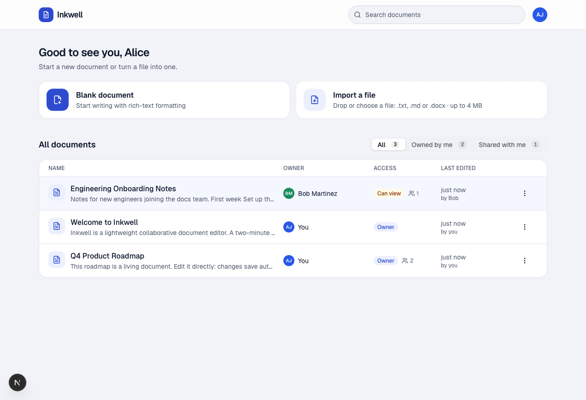
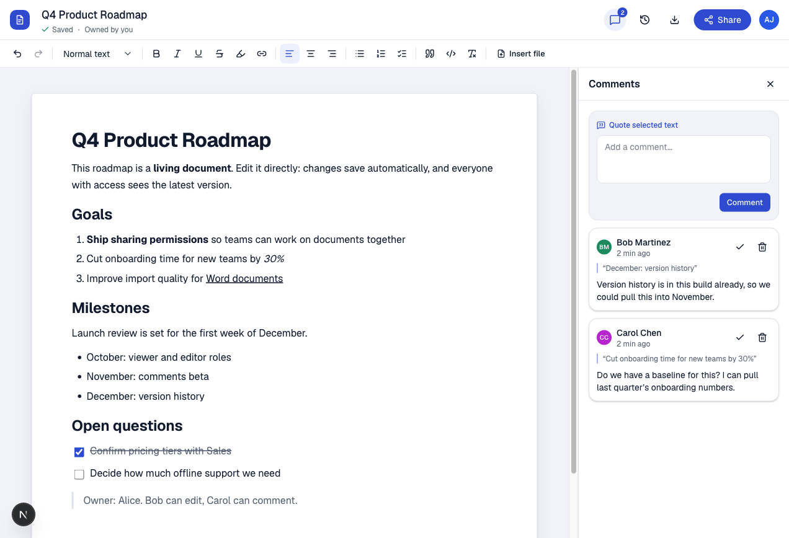
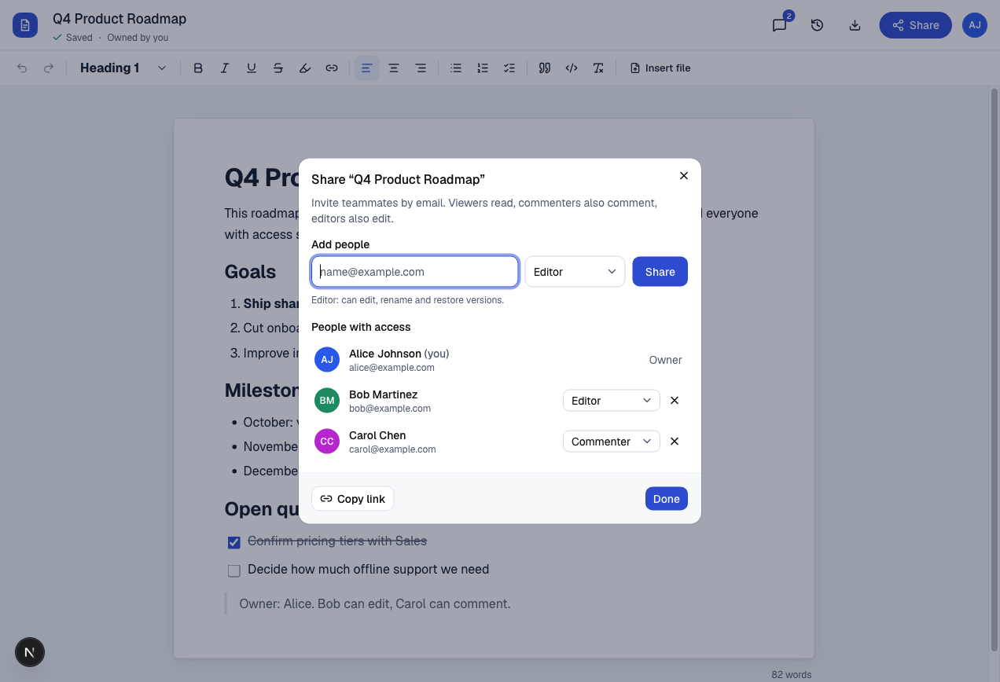
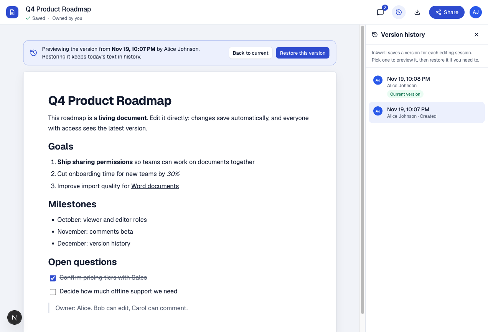

# Inkwell

Inkwell is a lightweight collaborative document editor inspired by Google Docs. Teams can create, format, import, comment on and share documents, with owner, editor, commenter and viewer roles enforced on the server.

**Live app:** https://inkwell-docs-app.vercel.app
**Source:** https://github.com/saimulft/inkwell-docs
**Walkthrough video (3 min 39 s):** https://vimeo.com/1248383864/b9bb502a27

More detail: [architecture note](docs/architecture.md) · [AI workflow note](docs/ai-workflow.md) · [submission contents](SUBMISSION.md)

## Demo accounts

Sign-in is a demo flow with seeded accounts and no passwords. On `/login`, click an account to sign in. To switch users later, use the avatar menu (top right) and pick **Switch demo account**.

| Account                             | Role in the demo data                                                                                                   |
| ----------------------------------- | ----------------------------------------------------------------------------------------------------------------------- |
| `alice@example.com` (Alice Johnson) | Owns **Q4 Product Roadmap** (Bob can edit, Carol can comment, two seeded comments) and **Welcome to Inkwell** (private) |
| `bob@example.com` (Bob Martinez)    | Owns **Engineering Onboarding Notes** (shared with Alice as viewer). Editor on the roadmap                              |
| `carol@example.com` (Carol Chen)    | Owns **Design Review Checklist** (private). Commenter on the roadmap                                                    |

Sessions are real: a random token is stored hashed in the database and sent as an httpOnly cookie. Only the password step is skipped.

## Review it in 2 minutes

1. Open https://inkwell-docs-app.vercel.app and sign in as **Alice**.
2. Open **Q4 Product Roadmap**. Type something, use the toolbar (bold, italic, underline, headings, lists, checklist) and watch the status under the title go from "Saving…" to "Saved". Reload: everything is still there, formatting included.
3. Click **Share**: Bob is an Editor and Carol a Commenter. Add or change a role, or try an unknown email to see the validation message.
4. Open a private window and sign in as **Bob**. The roadmap is under **Shared with me** with a "Can edit" badge. With it open in both windows, each user shows up as an avatar, which turns into a pulsing "is editing" badge while they type, and Bob's saved edits appear in Alice's editor within a few seconds.
5. Sign in as **Carol** and open the roadmap: the page is read-only, but she can select text, open **Comments** (speech bubble in the header) and comment on it. Back as Alice, resolve or delete the comment.
6. As Alice or Bob, open **Version history** (clock icon), preview an older version and **Restore** it. Use the download icon to get the document as **Markdown** or **PDF**.
7. Back on the home page, **Import a file**: drop a `.md`, `.txt` or `.docx`. It becomes a new document you own, with headings, lists and bold/italic/underline kept. In an open document, **Insert file** in the toolbar adds a file's content at the cursor.

## Screenshots






## Features

- **Documents:** create, rename (inline title or the row menu), edit, delete (owner only, with confirmation), search by title or preview text, and an "All / Owned by me / Shared with me" filter with counts.
- **Editor (Tiptap v3):** bold, italic, underline, strikethrough, highlight, links, Heading 1 to 3, bulleted, numbered and check lists, quotes, code blocks, text alignment, clear formatting, undo/redo, keyboard shortcuts and a word count.
- **Saving:** autosave 800 ms after you stop typing, Ctrl/Cmd+S to save now, a visible save status, a warning before leaving with unsaved changes, and a final flush when you navigate away inside the app.
- **Concurrent edits:** every save carries the version it started from. If someone saved in between, the server answers 409 and the editor shows a banner: **Load their version** or **Keep mine**. Nothing is overwritten silently.
- **Sharing and roles:** the owner adds people by email as **Viewer** (read), **Commenter** (read and comment) or **Editor** (edit text and title, restore versions), changes roles and removes people. Collaborators can see who has access and can remove a shared document from their own list. "Copy link" copies the document URL; only people with access can open it.
- **Comments:** a side panel with an open-comment count in the header. Select text first and the comment quotes it. Commenters, editors and the owner can comment, resolve and reopen; authors and the owner can delete; viewers can read the discussion.
- **Version history:** editors and the owner see a version per editing session (autosaves by the same person within 5 minutes fold into one), labelled "Created", "Imported from file.md" or "Restored from version N". Preview any version read-only, then restore it; the restore is saved as a new version, so it can be undone too.
- **Export:** download as Markdown (`.md`) or as PDF through the browser's print dialog, with a print stylesheet that hides the app around the page.
- **Collaboration indicators:** while a document is open, the editor sends a heartbeat every 4 seconds. It shows who else is here and whether they are viewing or editing, pulls in a collaborator's saves when you have no unsaved edits, refreshes the comment count, picks up renames, and applies a role change or revoked access without a reload.
- **File import:** see below.

## Optional stretch (all five done)

- **Real-time collaboration indicators:** presence avatars with viewing and editing states, and a "Bob is editing" status line.
- **Commenting:** quoted-text comments with resolve, reopen and delete rules per role.
- **Document version history:** session snapshots with read-only preview and undoable restore.
- **Export to PDF or Markdown:** Markdown download plus print-to-PDF.
- **Role-based sharing permissions beyond basic access:** viewer, commenter and editor, enforced by one server-side permission function.

## Supported import files

| Type       | Extensions         | What is kept                                                                             |
| ---------- | ------------------ | ---------------------------------------------------------------------------------------- |
| Plain text | `.txt`             | Paragraphs (blank lines) and line breaks                                                 |
| Markdown   | `.md`, `.markdown` | Headings, bold, italic, links, lists, quotes, code. Raw HTML is shown as text, never run |
| Word       | `.docx`            | Headings, paragraphs, lists, bold, italic, underline, strikethrough                      |

The limit is **4 MB per file**. Vercel functions reject request bodies over 4.5 MB, so 4 MB keeps a clear error message in the app instead of a platform error. The same limits are shown in the UI and enforced on the server. Images, tables and custom fonts or colours are not imported.

## Run it locally

Requirements: Node.js 22 or newer and npm.

```bash
npm install
npm run dev
```

Open http://localhost:3000 and pick a demo account.

There is nothing else to set up. Without `DATABASE_URL`, the app uses [PGlite](https://pglite.dev), an embedded Postgres, stored in `.data/pglite`. It is migrated and seeded on the first request. To reset the demo data, stop the dev server and delete the `.data` folder.

To use a real Postgres database instead, put the connection string in `.env` as `DATABASE_URL`, then run:

```bash
npm run db:setup
```

`db:setup` applies the migrations in `drizzle/` and seeds the demo accounts and sample documents. Seeding is idempotent: accounts are upserted, and sample documents are only created in an empty database. `npm run db:reset -- --yes` wipes documents, comments, versions and sessions in that database and seeds it again.

## Scripts

| Script                      | What it does                                                           |
| --------------------------- | ---------------------------------------------------------------------- |
| `npm run dev`               | Start the dev server on port 3000                                      |
| `npm run build`             | Production build                                                       |
| `npm run start`             | Serve the production build                                             |
| `npm test`                  | Run the Vitest suite                                                   |
| `npm run lint`              | ESLint plus file-name lint (ls-lint)                                   |
| `npm run typecheck`         | Generate Next.js route types, then `tsc --noEmit` (strict mode)        |
| `npm run format`            | Format with Prettier (`format:check` to verify only)                   |
| `npm run db:generate`       | Generate a SQL migration from `src/lib/db/schema.ts`                   |
| `npm run db:setup`          | Migrate and seed the database at `DATABASE_URL`                        |
| `npm run db:reset -- --yes` | Hosted database only: migrate, wipe documents and sessions, seed again |

## Tests

```bash
npm test
```

32 tests in 5 files, using Vitest with an in-memory PGlite database, so they run real Postgres SQL with no setup.

- `tests/permissions.test.ts`: the role-to-capability map; the access matrix for owner, editor, viewer and a stranger (view, edit, rename, share, delete); owned versus shared-with-me lists; share validation (unknown email, sharing with the owner, updating instead of duplicating a share); revocation and leaving; presence; owner-only delete; rejecting content the editor schema cannot represent; and the optimistic-concurrency conflict on a stale save.
- `tests/collaboration.test.ts`: commenter rules (can comment, cannot edit); comment resolve and delete permissions, and viewers kept out of the discussion; version history folding rapid autosaves, starting a new version after 5 minutes or for another person, and restoring as a new version; history hidden from people who cannot edit; the "is editing" presence signal.
- `tests/import.test.ts`: Markdown, plain text and Word conversion keeps headings, lists, line breaks and bold/italic/underline; raw HTML in Markdown is shown as text; unsupported, empty, oversized and fake files are rejected.
- `tests/markdown.test.ts`: Markdown export keeps headings, marks, links, nested and task lists and quotes; escapes Markdown syntax typed as text; builds safe file names.
- `tests/api.test.ts`: route handlers end to end: 401 without a session, 422 for unknown accounts and malformed input, 403 for cross-site writes, then create, share, save and protect a document (including 404 for a stranger and 409 for a stale save), and import with 415 for an unsupported file.

## Deployment

The source is a public GitHub repo, https://github.com/saimulft/inkwell-docs. Production deploys from pushes to `main` through Vercel's Git integration, on a personal Vercel account (Hobby, free) with a **Neon Postgres** database (free tier, added through the Vercel Marketplace) connected as `DATABASE_URL`. Vercel runs the `vercel-build` script, which applies migrations and the idempotent seed, then runs `next build`. Reviewers don't need any paid service.

## Project structure

```text
src/
  app/
    page.tsx                    documents home
    login/                      demo account picker
    documents/[id]/             editor page
    api/
      auth/login, auth/logout
      documents/                list, create
      documents/[id]/           read, rename or save, delete
      documents/[id]/access/    list, share, change role, remove
      documents/[id]/comments/  list, add, resolve or reopen, delete
      documents/[id]/versions/  list, read one, restore
      documents/[id]/presence   heartbeat and leave
      import/                   file to new document, or to content
      users/                    team directory for sharing
  components/                   home list, share dialog, editor, toolbar, comments and history panels, shadcn/ui
  lib/
    db/                         Drizzle schema, Postgres or PGlite client, seed
    auth/                       sessions and cookies
    services/                   access rules, documents, sharing, comments, versions, presence
    editor/                     shared editor schema, content validation, Markdown export
    import/                     .txt, .md and .docx conversion
  proxy.ts                      sends signed-out visitors to /login
drizzle/                        SQL migrations
tests/                          Vitest suite
scripts/                        db-setup.ts (migrate and seed), db-reset.ts (wipe and seed again)
docs/                           architecture and AI workflow notes
```

## Status

**Working end to end:** demo sign-in and switching, create, rename, edit, autosave, reopen, delete, rich-text formatting, `.txt`/`.md`/`.docx` import as a new document or into an open one, sharing with viewer, commenter and editor roles enforced on the server, owned and shared lists, comments, version history with restore, Markdown and PDF export, persistence in Postgres, conflict detection with a resolution banner, presence with viewing and editing states, pulled remote updates, validation and error states, automated tests, live deployment from GitHub.

**Incomplete or known limits:**

- No real-time co-editing (CRDT). Two people typing at the same moment get a conflict banner instead of a merge.
- Presence, remote updates and new comments use 4-second polling, so they lag by a few seconds.
- Comments quote the selected text but are not anchored to a live range, so they don't move with edits. Comment threads are flat, with no replies or mentions.
- PDF export uses the browser's print dialog, not server-side rendering.
- Demo sign-in has no passwords by design; anyone with the URL can pick any demo account. No email notifications.
- No images, in documents or imports. `.docx` import keeps structure (headings, lists, emphasis), not exact styling.

**Next, with another 2 to 4 hours:**

1. Real-time co-editing with Yjs and Hocuspocus and live cursors, on a host that keeps WebSockets open, using the same access rules for the socket. This would also anchor comments to Yjs relative positions.
2. Comment replies and mentions, then a suggestion mode.
3. Real sign-in (SSO or email magic link) and rate limiting on the API.
4. Server-side PDF export.
